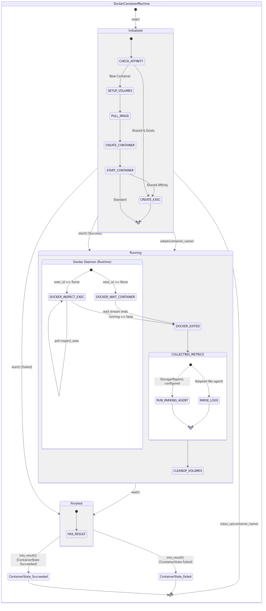

# stormchaser-runner-docker

The Docker runner (`stormchaser-runner-docker` binary). It takes container steps from NATS and runs them on a Docker host: pulls the image, unparks storage through the agent, runs the container on a step network away from the control plane, streams logs, parks storage and publishes artifacts, and reports the result. It adopts its own containers after a restart, cleans up orphaned ones, and refuses privileged steps unless `STORMCHASER_ALLOW_PRIVILEGED=true`.

## State Machine

The runner uses a Rust typestate machine (`container_machine/`) to govern the lifecycle of a Docker container and its integration with the Docker Engine API.

---

## About Stormchaser

Stormchaser is a distributed workflow engine for event-driven and human-triggered workflows, written in Rust. Workflows are written in an HCL-based DSL; the engine keeps state in PostgreSQL and passes events over NATS JetStream.

For more information, full documentation, and examples, please visit the [Stormchaser GitHub Repository](https://github.com/paninfracon/stormchaser) and read the [Main Project README](https://github.com/paninfracon/stormchaser/blob/trunk/README.md).
