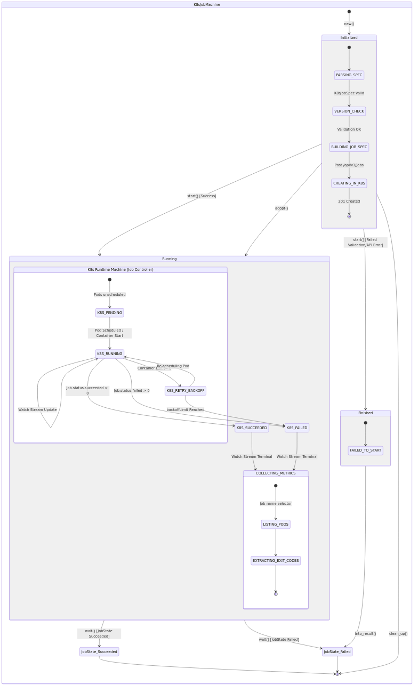

# stormchaser-runner-k8s

The Kubernetes runner (`stormchaser-runner-k8s` binary). It takes container and `RunK8sJob` steps from NATS and runs each as a Kubernetes Job in a step namespace separate from its own, with the step's environment in a per-step Secret, an agent sidecar for storage parking, and resource limits within the runner's maximums. It adopts its Jobs after a restart and cleans up finished ones. It is built against the Kubernetes 1.32 API.

## State Machine

The runner uses a Rust typestate machine (`job_machine/`) to govern the lifecycle of a Kubernetes Job and its integration with the Kubernetes Job controller API.

---

## About Stormchaser

Stormchaser is a distributed workflow engine for event-driven and human-triggered workflows, written in Rust. Workflows are written in an HCL-based DSL; the engine keeps state in PostgreSQL and passes events over NATS JetStream.

For more information, full documentation, and examples, please visit the [Stormchaser GitHub Repository](https://github.com/paninfracon/stormchaser) and read the [Main Project README](https://github.com/paninfracon/stormchaser/blob/trunk/README.md).
