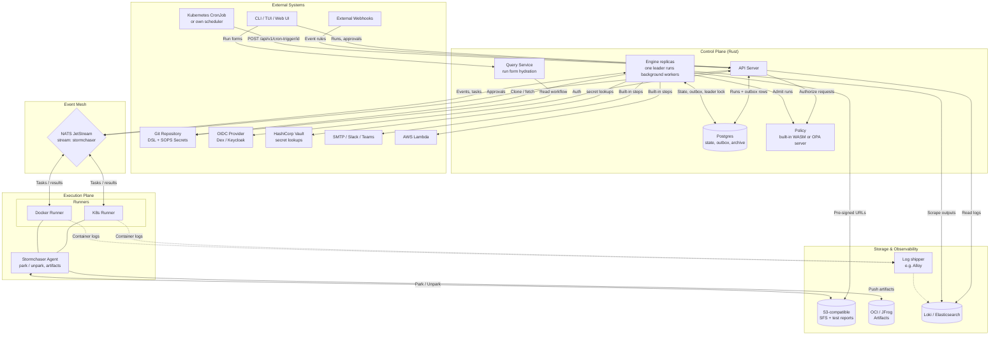

# Stormchaser Architecture

This document describes how Stormchaser is built: its components, how a run moves
through them, and what the system guarantees. It describes the code as it is. Parts
of the original design that are not built are listed at the end, under
[Design targets (not yet implemented)](#design-targets-not-yet-implemented).

See also: [State machines](state_machines.md), [NATS](nats.md),
[Quotas](quotas.md), [Affinity](affinity.md), [Security](security.md),
[Observability](observability.md).

## System Diagram

The same diagram is in `architecture.mmd`.

## Crates

| Crate | Role |
| :--- | :--- |
| `stormchaser-api` | HTTP API: runs, approvals, webhooks, cron triggers, connections, logs. |
| `stormchaser-engine` | Orchestration engine: resolves runs, schedules and dispatches steps, runs built-in steps, background workers. |
| `stormchaser-core` | Code the API, the engine and the query service share, so none depends on another: HTTP service settings and start-up, Postgres TLS, migrations, the log backends, the SSRF guard, token checks and the policy middleware, object authorization, the Git cache, input queries and the jq sandbox, approval links, the outbox inserts. |
| `stormchaser-runner-docker`, `stormchaser-runner-k8s` | Pull tasks from NATS and run them as containers or Kubernetes Jobs. |
| `stormchaser-runner-core` | What the runners share: the runner's life (NATS, session key, registration, orphan adoption, heartbeat, task and cancellation consumers, shutdown) around a `Backend` trait each runner implements, the encryption of the step definitions kept on workloads, and reading the agent's marked log lines. |
| `stormchaser-agent` | Runs beside a step to park and unpark storage and push artifacts. |
| `stormchaser-query` | Hydrates run forms from a workflow's schema and queries, read from Git. |
| `stormchaser-client` | Typed client of the API and the query service, over the request and response types in `stormchaser_model::api`. |
| `stormchaser-cli`, `stormchaser-tui`, `stormchaser-web` | Clients. |
| `stormchaser-dsl` | HCL parser for `.storm` workflows. |
| `stormchaser-model` | Shared types (runs, steps, events, DSL AST), plus the NATS helpers and runner identity code the services and runners share. On native targets it depends on `tokio`, `sqlx` and `async-nats`. |
| `stormchaser-opa` | The policy client (`OpaClient`, `OpaAuthorizer`): asks OPA over HTTP, or evaluates a WASM policy, the shipped one by default. |
| `stormchaser-tls` | Certificate loading and reload. |

## Triggering & Scheduling

A run starts in one of four ways:

* **API request**: `POST /api/v1/runs` names a workflow in Git. The API writes the
  run (`queued`) and a `run.queued` event to `outbox_events` in one transaction.
* **Direct run**: `POST /api/v1/runs/direct` (`stormchaser run <file>`) carries the
  workflow text. The API parses it, refuses it with `400` if it does not parse, and
  queues a `run.direct` event through the outbox. The engine creates the run when it
  accepts it, or records it as failed with the reason.
* **Webhook event rule**: an inbound webhook that matches an event rule queues a run
  like an API request.
* **Cron**: see below.

### CronWorkflows

Stormchaser keeps no timer loop of its own. Schedules are stored in the
`cron_workflows` table and fired by an external scheduler.

* **Trigger**: each schedule has a `secret_token`. The scheduler calls
  `POST /api/v1/cron-trigger/{id}` with `Authorization: Bearer <token>`.
* **Engines** (`CRON_ENGINE`, default `kubernetes`):
  * `kubernetes`: the API creates a `CronJob` that calls the trigger URL with `curl`.
  * `none`: the API stores the schedule and shows its token once; a scheduler of
    the operator's own (cron, a systemd timer, a CI schedule) calls the trigger URL.
    The Docker quickstart uses this.
* **Identity**: cron runs are initiated by `system:cron`.

Schedules are managed through the API (`/api/v1/cron-workflows`); a workflow file has no `cron` attribute that the engine reads.

## Life of a run

1. The API (or the engine, for a direct run) creates the run and its `run_contexts`
   row. The starting event goes through the outbox.
2. The engine handles `run.queued`: it moves the run to `resolving`, reads the
   workflow from Git, asks policy whether the run may go ahead, runs the workflow's
   queries, validates inputs and decrypts SOPS secrets. It then moves the run to
   `start_pending` and queues `run.start_pending`.
3. On `run.start_pending` the engine creates the first step instances and moves the
   run to `running`.
4. The engine claims pending steps (`FOR UPDATE SKIP LOCKED`) up to the run's
   concurrency and CPU/memory quotas, and dispatches each one:
   * A runner step (`RunContainer`, `RunK8sJob`, and types that become them, such as
     Terraform and Git checkout) is published as a task message on
     `stormchaser.v1.<shard>.step.scheduled.<type>`. A runner pulls it, runs it, and
     reports progress and the result as `step.*` events.
   * A built-in step (`RestApi`, `SqlExecute`, `JQ`, `JinjaRender`, `WebhookInvoke`,
     `EmailSend`, `TestReportEmail`, `LambdaInvoke`, `SlackMessage`, `TeamsMessage`,
     `Wasm` and WASM-registered types) runs inside the engine. It records the engine's
     id on the step and reports its result through the outbox.
   * `Approval` and `Wait` steps are created `waiting_for_event` and are finished by
     the API when someone approves or rejects, or a correlated event arrives.
5. Each `step.completed` or `step.failed` locks the run's row, records the result,
   creates the next steps or ends the run, and dispatches what is now pending.
6. A finished run is archived: its rows move to the `archived_*` tables.

## Component Roles

### 1. Control Plane

* **API Server** (`stormchaser-api`): authenticates callers (OIDC or the API's own
  JWTs), asks policy about every request, and creates runs. It serves run, step and
  log reads, and masks a run's secrets in everything it returns (see Secret masking
  below). It manages connections (storage, registry, Git), webhooks, event rules and
  cron schedules. Approvals and rejections are published to NATS directly as
  `step.completed` / `step.failed` events.
* **Query Service** (`stormchaser-query`): `POST /api/v1/schema/hydrate` and
  `/hydrate-direct` fill a run form from the workflow's input schema and queries.
* **Engine** (`stormchaser-engine`): consumes events from JetStream and drives the
  run and step state machines. Each replica:

  * pulls from the shared durable consumers `orchestration-engine-shard-<n>` for each
    shard in `STORMCHASER_ASSIGNED_SHARDS` (default `0`), `orchestration-engine-global`
    (with shard 0) and the `orchestration-engine-legacy-{run,runner,step}` consumers
    for unsharded subjects. Replicas bound to the same consumer share its messages;
  * answers request-reply subjects outside the stream on queue group
    `engine-query-group`: `stormchaser.rpc.step.query` (is a step a runner found
    still wanted), `stormchaser.rpc.step.artifact_auth` (registry push credentials)
    and `stormchaser.rpc.runner.session` (runner keys);
  * handles each event in its own task, sends JetStream progress acks every 10 s
    while a handler runs, and settles the event when it finishes (see
    [Delivery and retries](#delivery-and-retries));
  * records a heartbeat in `engine_instances` every 10 s;
  * competes for leadership of the background workers (see
    [Background workers](#5-background-workers-and-leader-election)).

  `STORMCHASER_ASSIGNED_SHARDS` is a static list read at start-up. Nothing moves
  shards between replicas, and the Helm charts and compose files do not set it, so
  every replica consumes shard 0. `STORMCHASER_TOTAL_SHARDS` (default `1`) sets how
  many shards run ids hash into (CRC32 of the run id); it must be the same for the
  API, the engine and the runners.

* **SFS coordination**: for a step that uses `storage`, the engine picks the SFS
  storage backend, generates pre-signed GET and PUT URLs, and includes them in the
  task with the SHA-256 of the volume's last parked archive. The runner restores the
  archive only if its hash matches. See [SFS testing](sfs_testing.md).
* **Approvals and waits**: an `Approval` step waits for `POST
  /api/v1/runs/{id}/steps/{step_id}/approve` or `/reject`, or for a signed approval
  link sent by email. The API checks the step is an approval waiting for a decision
  and that the caller may decide it, records the decision in `approval_registry`, and
  publishes the result. One approval decides the step. A `Wait` step waits for
  `POST /api/v1/events/correlate` with its correlation key and value
  (`event_correlations`).
* **Step status history**: every transition made through the step state machine
  writes a row to `step_status_history`. See [State machines](state_machines.md).
* **PostgreSQL**: runs (`workflow_runs`, `run_contexts`, `run_quotas`), steps
  (`step_instances`, `step_outputs`, test reports), runners (`runners`,
  `runner_sessions`), engines (`engine_instances`), the outbox (`outbox_events`),
  task message positions (`dispatched_task_messages`), configuration (connections,
  webhooks, event rules, cron schedules) and the `archived_*` tables. Migrations are
  applied by one command, `stormchaser-engine migrate`: the Helm chart runs it in an
  init container of the engine pod, and compose in a one-shot `migrate` service. The
  API and the engine wait at start-up until the schema has every migration they were
  built with (`STORMCHASER_SCHEMA_WAIT`, 5 minutes by default), or apply them
  themselves with `STORMCHASER_MIGRATE_ON_START=true`. `STORMCHASER_DB_MAX_CONNECTIONS`
  (default 10) sizes each service's pool.
* **Policy (OPA)**: the API asks policy about every request, with the caller's
  verified identity and, for runs, connections, webhooks, event rules and cron
  schedules, the object's owner. The engine asks it before a run is resolved
  (`check_context`, before any query runs) and before a run uses a connection.
  * With `OPA_WASM_PATH` set, the services evaluate that WASM policy (with
    `OPA_DATA_PATH` as its data). With only `OPA_URL` set, they ask that OPA server.
    With neither, they enforce the shipped policy, built in as WASM.
  * `STORMCHASER_AUTHZ_DISABLED=true` turns policy off in debug builds only; a release
    build refuses to start with it.
  * Policy errors deny. An OPA server that cannot be reached while a run is being
    admitted is a transient error: the event is delivered again with backoff, and
    after 10 deliveries the run is recorded as failed.

### 2. Event Mesh (NATS)

* **Stream**: every component shares one JetStream stream, `stormchaser`, capturing
  `stormchaser.v1.>`. The engine creates it; runners only wait for it. Messages are
  removed by the stream's maximum age (`STORMCHASER_NATS_STREAM_MAX_AGE_HOURS`,
  default 168) unless the engine erases them sooner.
* **Subjects**: run and step events are `stormchaser.v1.<shard>.run.*` and
  `stormchaser.v1.<shard>.step.*`; runner lifecycle events are
  `stormchaser.v1.global.runner.{register,heartbeat,offline}`; the engine tells
  runners to stop a run's steps on `stormchaser.v1.runner.cancel`.
* **Task consumers**: runners pull tasks from shared durable consumers.
  `runner-container-tasks` (`stormchaser.v1.*.step.scheduled.runcontainer`) is shared
  by Docker and Kubernetes runners, so each `RunContainer` task runs once.
  `runner-k8s-job-tasks` (`stormchaser.v1.*.step.scheduled.runk8sjob`) serves
  Kubernetes runners. Each runner also consumes its own subject,
  `stormchaser.v1.runner.<kind>.<runner_id>`, used for `shared` affinity.
* **Events are CloudEvents**, validated against their JSON schema before the engine
  handles them. Runner events are signed with a per-runner key the engine issues
  (`stormchaser.rpc.runner.session`), and the engine accepts a step's result only from
  the runner the step is with.

Users, permissions and production settings are in [NATS](nats.md).

### 3. Execution Plane

* **Runners** register on start (`runner.register`, with `runner_type`,
  `protocol_version`, `capabilities` and the step types they serve, saved in
  `runners`), send a heartbeat every 10 s, pull tasks, run them, and report
  `step.initializing`, `step.unpacking_sfs`, `step.running`, `step.packing_sfs`,
  `step.completed` and `step.failed`. A runner's id defaults to its host or pod name
  (`docker-<host>`, `k8s-<pod>`), or `RUNNER_ID`, so a restarted runner keeps its
  steps.
* **Agent**: parks and unparks a step's storage and pushes its artifacts, as a
  separate container on Docker and a sidecar on Kubernetes, so that the step's own
  code does not hold the upload URLs or push credentials.
* **Runner liveness**: the liveness worker marks a runner `offline` when it has sent
  no heartbeat for 30 seconds, and fails as `lost_zombie` each of its steps in
  `running`, `unpacking_sfs` or `packing_sfs`. Another runner may take over a
  redelivered task once the step's runner has been silent for 12 seconds
  (`RUNNER_QUIET_SECS`). Liveness is per runner; there is no per-task heartbeat.
* **Engine liveness**: a built-in step records the engine running it (`engine_id`).
  When that engine has sent no heartbeat for 60 seconds, the liveness worker fails
  the step, except `JQ` and `JinjaRender` steps, which have no side effects and are
  put back to `pending` to run again. Engines silent for 24 hours with no steps are
  deleted from `engine_instances`.
* **Cancellation**: when a running run fails or is aborted, the engine queues a
  `stormchaser.v1.runner.cancel` message and every runner stops the containers or
  Jobs it holds for the run.

### 4. Distributed Consistency & Persistence

* **Run row lock**: the step completed and failed handlers lock the run's row
  (`SELECT … FOR UPDATE`) before reading or changing its steps. This serialises the
  events of one run across handlers and replicas.
* **Optimistic concurrency on runs**: run transitions made through `WorkflowMachine`
  update `workflow_runs` with `WHERE version = $n` and fail on a mismatch. Step
  updates have no version check.
* **Guarded step transitions**: a trigger on `step_instances` refuses a move a step
  may not make, so a finished step is never changed again, and records every status
  change in `step_status_history` (see [State machines](state_machines.md)).
* **Completion tokens**: a built-in step has a `completion_token`, which must
  accompany the event that finishes it. A runner step's token is cleared when its
  task is published; from then on only its assigned runner may report on it. A retry
  gives the step a new token, so a late report from an earlier attempt is ignored.
* **Fencing tokens**: each run has a `fencing_token`, set once when the run is
  created and copied into its tasks and events. It never changes, so the engine no
  longer compares it; the field stays in events for compatibility.
* **Transactional outbox**: events written in the same transaction as the state
  change they report go to `outbox_events`. This covers run-starting events from the
  API (`run.queued`, `run.direct`), engine run events (`run.start_pending`,
  `run.running`, `run.completed`, `run.failed`, `run.aborted`), `runner.cancel`,
  built-in step results, and the `step.failed` events the liveness worker raises.
  The outbox relay (see below) publishes them.
* **Not through the outbox**: task messages to runners are published directly,
  because they carry resolved secrets that should not be stored in Postgres. The
  step is marked `dispatched_at` first; the dispatch recovery worker puts back a step
  claimed for more than 5 minutes and never published. The API publishes approval
  decisions and correlated events directly. Runners publish their events directly.
* **Idempotent handlers**: an event delivered again for a step already finished does
  nothing except archive the run if that is still owed. A `start_pending` event for a
  run that has started is skipped. A failure report for an attempt already put back
  for retry is ignored.

#### Delivery and retries

* An event whose handler fails transiently (database or broker unreachable, dropped
  connection, serialization failure or deadlock, OPA unreachable) is negatively
  acknowledged with a delay doubling from 1 s up to 60 s, and delivered again, up to
  10 deliveries (`retry.rs`). Other failures are acknowledged and logged.
* When the engine gives up on a run's starting event, the run is recorded as failed
  with the reason rather than left `queued`.
* A built-in step's result is written with retries for up to 10 minutes while the
  database is unreachable, since no event would bring it back.

#### Step retries

A step's `retry` block (`count`, `backoff`, `delay`, `max_delay`) makes a failed or
lost step run again. The failed handler puts it back to `pending` with `attempt`
incremented and `retry_at` set, and the run waits. The retry worker dispatches it once
`retry_at` passes. `Approval` and `Wait` steps are never retried. Retried attempts are
counted in `stormchaser.v1.steps_retried`. See "Retries" in
[Workflow DSL](workflow_dsl.md).

#### allow_failure

A step with `allow_failure = true` that fails is marked `failed_ignored` and its run
goes on as if it had succeeded. A `lost_zombie` step still fails its run.

### 5. Background workers and leader election

One engine replica at a time runs the background workers. The replicas compete for a
Postgres advisory lock (`pg_try_advisory_lock`, key `0x73746f726d636872`) every 5
seconds. The winner holds it on a connection taken out of the pool and checks every 5
seconds that the connection answers; when it does not, the replica stops its workers
and another takes the lock. An engine whose heartbeat or leader election task stops
exits so that it is restarted. Shard assignment does not affect leadership.

| Worker | Interval | What it does |
| :--- | :--- | :--- |
| Liveness | 15 s | Marks silent runners offline; fails their in-flight steps as `lost_zombie`; fails or resets built-in steps of engines silent for 60 s; forgets engines gone for 24 h. |
| Timeout | 30 s | Aborts runs past their `timeout` (default 24 h) and fails their unfinished steps, then archives them. |
| Resolver crash recovery | 60 s | Fails runs left `resolving` for more than 5 minutes. |
| Outbox relay | 500 ms | Publishes up to 100 `outbox_events` rows per pass, oldest first (`FOR UPDATE SKIP LOCKED`), with `Nats-Msg-Id` set to the row id so the stream drops a duplicate. A row is deleted once the stream acknowledges it, and moved to the back of the queue when publishing fails. |
| Task message purge | 30 s | Erases the task messages of finished or archived steps from the stream, using `dispatched_task_messages`. |
| Dispatch recovery | 60 s | Puts back to `pending` steps claimed more than 5 minutes ago and never published, giving back their quota; dispatches running runs with steps pending for more than 60 seconds. |
| Retry | 5 s | Dispatches running runs with a step whose `retry_at` has passed. |

### 6. GitOps & Secrets

* **Git**: the engine clones repositories into its git cache (`GIT_CACHE_DIR`) when
  a run is resolved. A branch or tag is fetched again after
  `STORMCHASER_GIT_CACHE_REFRESH_SECS` (default 60); a full commit id is never
  refetched. Clones are limited by `STORMCHASER_GIT_MAX_CLONE_MB`,
  `STORMCHASER_GIT_CLONE_TIMEOUT_SECS` and `STORMCHASER_GIT_ALLOWED_SCHEMES`. There is
  no background sync. In Kubernetes a `ReadWriteOnce` cache limits the engine to one
  replica; the chart refuses more.
* **SOPS**: when a run is resolved, the engine decrypts the run's SOPS file from the
  repository (optionally assuming `sops_role_arn` for AWS KMS). A run whose secrets
  cannot be decrypted fails. Decrypted secrets are stored in `run_contexts.secrets`
  and read from there by later steps. The application does not encrypt them;
  encrypting the database at rest is the operator's job (see [Security](security.md)).
* **Vault**: with `VAULT_TOKEN` (and `VAULT_ADDR`) set, workflow expressions can call
  `secret()`. Values fetched this way are recorded for masking.
* **Secret masking**: each run has a `sensitive_values` list in `run_contexts`,
  filled from decrypted SOPS secrets, values fetched with `secret()` (in expressions
  and query parameters), and connection and registry credentials handed to steps. The
  API also masks the run's `secret = true` inputs. It replaces each value, and its
  base64, URL, JSON-escaped and hex encodings, with `********` in run details, step
  outputs, errors and log lines it returns, and masks outright any output marked
  sensitive (`step_outputs.is_sensitive`). Masking happens when the API reads; logs in
  Loki or Elasticsearch, and a step's own output, are not redacted.

### 7. Resource Quota Enforcement

* Each run has a row in `run_quotas`: `max_concurrency`, `max_cpu`, `max_memory`,
  `max_storage` and `timeout`, from the workflow's `quotas` block, held to the
  operator's ceilings (`STORMCHASER_RUN_MAX_*`). See [Quotas](quotas.md).
* **Concurrency**: the engine claims no more pending steps than `max_concurrency`
  minus the run's steps in `running`. Iterations also respect a step's
  `max_parallel`.
* **CPU and memory**: before dispatch the engine claims the step's requested CPU and
  memory against the run's `max_cpu` and `max_memory` (`current_cpu_usage`,
  `current_memory_usage`). A step that does not fit goes back to `pending`; a step
  that asks for more than the whole run may use fails. The claim is given back when
  the step finishes or its dispatch is lost.
* **Timeout**: the timeout worker aborts a run past its `timeout`, fails its
  unfinished steps and tells runners to stop them.
* `max_storage` is stored but not enforced.

### 8. Housekeeping & Data Retention

* **Archiving**: a finished run's rows move from the live tables to
  `archived_workflow_runs`, `archived_run_contexts`, `archived_step_instances`,
  `archived_step_outputs`, `archived_step_status_history`, the archived test report
  tables, `archived_artifact_registry` and `archived_run_storage_states`. The
  `combined_*` views read live and archived rows together.
* **Nothing expires archived rows.** They are kept until deleted with
  `DELETE /api/v1/runs/{id}`, which removes the run from both live and archived
  tables.
* **NATS**: task messages are erased once their step is finished or archived. Other
  messages age out with the stream's maximum age.
* **Parked SFS archives** in object storage are not deleted by Stormchaser; use the
  bucket's lifecycle rules.
* Runners reap containers or Jobs they manage that are older than 24 hours, checking
  every hour.

### 9. Affinity

`strategy { affinity = "shared" }` sends a run's shared steps to the runner the first
of them landed on, on that runner's own subject (`stormchaser.v1.runner.<kind>.<id>`).
Followers wait up to 30 seconds for the first step to be assigned. Each step is still
its own container or Job. See [Affinity](affinity.md).

## Runner Feature Comparison

| Feature | K8s Runner (`RunK8sJob` / `RunContainer`) | Docker Runner (`RunContainer`) |
| :--- | :--- | :--- |
| **Shared File System (SFS)** | Yes (init containers + agent sidecar) | Yes (sequential containers + parking container) |
| **SFS hash check** | Yes (SHA-256) | Yes (SHA-256) |
| **Orphan adoption** | Yes (startup scan, asks the engine) | Yes (startup scan, asks the engine) |
| **Metadata encryption** | AES-256-GCM in annotations | AES-256-GCM in labels |
| **Resource limits** | CPU/memory requests and limits | CPU quota and memory bytes |
| **Privileged mode** | Only with `STORMCHASER_ALLOW_PRIVILEGED=true` | Only with `STORMCHASER_ALLOW_PRIVILEGED=true` |
| **Garbage collection** | Hourly reaper, 24 h age | Hourly reaper, 24 h age |
| **Test reports** | Uploaded to engine-issued URLs | Uploaded to engine-issued URLs |
| **Secret/ConfigMap mounts** | Yes | No |
| **Parallelism/completions** | Yes (`RunK8sJob`) | No |

### Feature Explanations

#### 1. Shared File System (SFS) & Artifacts

Both runners implement park and unpark. Before a step starts, they download and
extract its storage volumes from the SFS backend, after checking the archive's
SHA-256 against the one the engine sent. After the step succeeds, they compress and
upload the modified files and report the new hash. Parking and artifact publishing
are done by a helper the step's own code does not share: a separate container on
Docker, an agent sidecar in the pod on Kubernetes. See [Security](security.md).

#### 2. Orphan Adoption & Recovery

On start, a runner scans for containers or Jobs that Stormchaser manages, asks the
engine on `stormchaser.rpc.step.query` whether each step is still wanted, and adopts
the ones that are. The engine moves the step to the adopting runner.

#### 3. Metadata Encryption

With `STORMCHASER_STATE_ENCRYPTION_KEY` set, step data stored in container metadata
(Kubernetes annotations or Docker labels) is encrypted with AES-256-GCM, so it is not
readable with `kubectl describe` or `docker inspect`.

#### 4. Resource Isolation

* **Kubernetes**: native `requests` and `limits` for CPU and memory.
* **Docker**: `CpuQuota` (CFS quota) and memory byte limits.

### Parallelism and Scheduling Models

#### 1. Native runtime scheduling (Kubernetes only)

`RunK8sJob` maps one step instance to one Kubernetes Job, whose `parallelism` and
`completions` the Job controller manages.

#### 2. Workflow-level iteration (any runner)

A step's `iterate` expression creates one step instance per item, each dispatched as
its own task. The engine enforces `max_parallel` per step and `max_concurrency` per
run; iterations beyond those start `waiting_for_event` and are started in order as
earlier ones finish.

## Design targets (not yet implemented)

The original design described the following. None of it is built; it is kept here
so that the gap is visible.

* **Sticky sharding with rebalancing**: replicas owning shards, handing them over
  with staggered reclamation and warm-up. Today shards are a static list per replica.
* **Fencing tokens that move**: incrementing a run's token when its owner changes,
  so that late results from the previous owner are rejected.
* **Optimistic concurrency on step updates.**
* **Per-task heartbeats and zombie investigation**: a dead-man switch per task and
  asking the runner about a silent task before failing it.
* **Runner protocol versioning**: rejecting runners below a minimum
  `protocol_version`, deprecation warnings, and dispatching only to runners that
  advertise a step's required capabilities. `protocol_version` and `capabilities` are
  stored and never checked.
* **`locked` affinity**: running a group of steps in one pod or task, with an agent
  watchdog that aborts a hung step.
* **Warm runner agent for `shared` affinity**: a persistent agent that pulls the
  group's steps, soft-resets between them (reap processes, clear environment and
  scratch space) and caches images.
* **DSL transformation**: upgrading older `stormchaser_dsl_version` workflows with
  AST transformations and a `DSL_DEPRECATED` warning. The version is parsed and
  stored only.
* **Multi-approval**: `require_approvals`, `on_partial` and `on_reject` blocks, and
  de-duplicating approvals by identity.
* **Retention policy engine**: a configurable retention period (30 days by
  default), a long-term audit table, and hard-deleting execution detail.
* **Log redaction in the pipeline**: a log shipper that redacts registered secrets
  before they are stored, and `::add-mask::` with real-time masking in the agent.
* **Storage quotas and I/O throttling**: enforcing `max_storage`, cgroup `blkio`
  limits from `storage.limits`, and I/O metrics from the agent.
* **Outbox relay notify**: waking the relay on commit instead of polling every
  500 ms.
