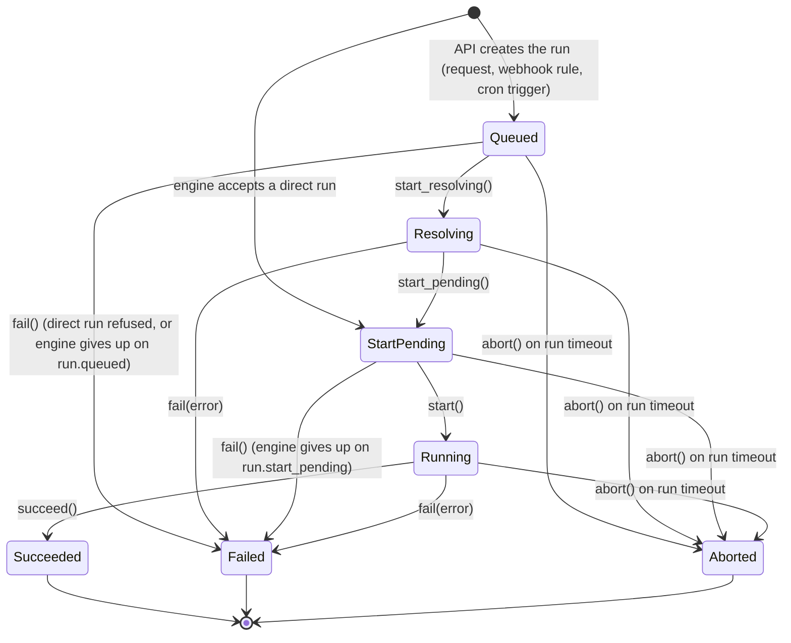
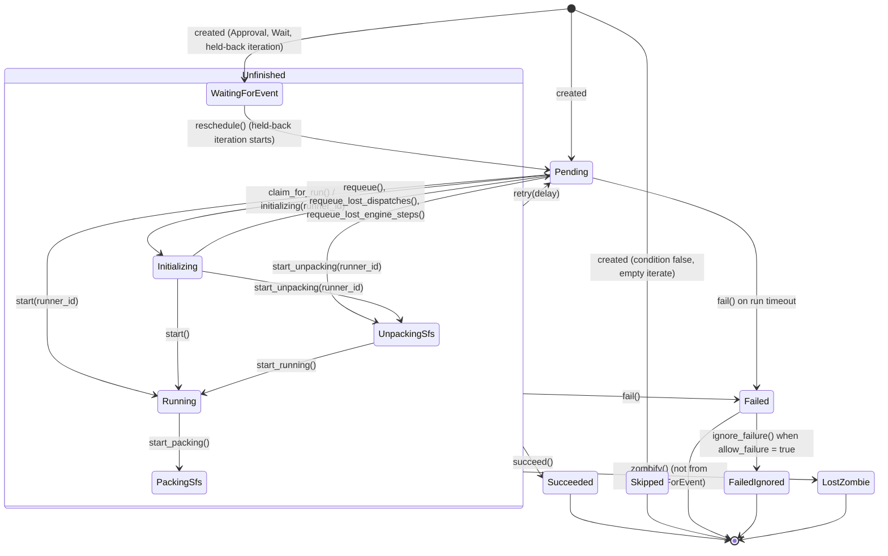

# Stormchaser State Machines

A run's status is `RunStatus` (`crates/stormchaser-model/src/workflow.rs`, Postgres
type `run_status`). A step's status is `StepStatus`
(`crates/stormchaser-model/src/step.rs`, Postgres type `step_status`).

The engine encodes the allowed transitions as typestate machines:
`WorkflowMachine<S>` in `crates/stormchaser-engine/src/workflow_machine.rs` and
`StepMachine<S>` in `crates/stormchaser-engine/src/step_machine/`. Every change to a
run's or a step's status is one of their transitions:

- **Loading is checked.** A handler builds a machine from the stored row with
  `load`, which refuses a row whose status is not one its state stands for. A
  handler that finds a run or step in another status than it expected logs it and
  leaves it alone.
- **Saving is a compare-and-set.** A transition saves only if the row still has the
  status the machine loaded (and, for a run, the same `version`); otherwise it fails
  without changing anything. Two handlers racing on the same row cannot both move it.
- **Set-based transitions are in the machine too.** Claiming a run's pending steps and
  putting back lost dispatches or the steps of a lost engine are statements in
  `step_machine/bulk.rs`, each checking the status it moves from.
- **The database refuses any other move.** Triggers on `workflow_runs` and
  `step_instances` refuse a status change the diagrams below do not allow
  (`run_status_transition_allowed` and `step_status_transition_allowed`, in the
  `guard_run_transitions` and `guard_step_transitions` migrations), with
  `check_violation`, whichever code makes it.
- **A test keeps it so.** `crates/stormchaser-engine/tests/status_writes_tests.rs` fails
  if any crate updates a run's or a step's status outside the machines and
  `persistence.rs`.

A run's result or a step's can overtake the reports that led up to it, because events
travel on separate subjects. So a step's end is the `Unfinished` state's transition:
`Unfinished` stands for every status a step has between being handed out and
finishing (`initializing`, `unpacking_sfs`, `running`, `packing_sfs`,
`waiting_for_event`), and a machine in one of those can be widened to it with
`unfinished()`.

The diagram sources are `workflow_machine.mmd` and `step_machine.mmd` in this
directory.

## Workflow state machine

| Status | Meaning |
| :--- | :--- |
| `queued` | The API has saved the run and queued its `run.queued` event through the outbox. |
| `resolving` | The engine is fetching the workflow from Git, checking policy, running queries and decrypting SOPS secrets. `started_resolving_at` is set. |
| `start_pending` | Resolved; the engine is about to create the first steps. |
| `running` | Steps are being created and dispatched. |
| `succeeded` | Every step finished in a status that lets the run go on. |
| `failed` | A step failed (without `allow_failure`), or the run could not be resolved or started. `error` says why. |
| `aborted` | The run's `timeout` passed. |

Where each transition happens:

- **Created `queued`**: `POST /api/v1/runs`, a webhook event rule, or a cron trigger.
  The run and its `run.queued` event are written in one transaction.
- **Created `start_pending`**: a direct run (`POST /api/v1/runs/direct`). The API
  only queues a `run.direct` event; the engine creates the run when it accepts it.
  A direct run the engine refuses for good (DSL, policy, query or input errors) is
  inserted as `queued` and failed (`Queued::fail`) in the same transaction, then
  archived.
- **`queued` to `resolving` to `start_pending`**: `handle_workflow_queued`
  (`handler/workflow/queued.rs`).
- **`resolving` to `failed`**: a resolution error that is not transient, or the
  resolver crash recovery worker, which fails runs left `resolving` for more than
  5 minutes.
- **`queued` or `start_pending` to `failed`**: the engine gave up on the run's
  starting event after 10 deliveries (`handler/workflow/abandon.rs`).
- **`start_pending` to `running`**: `handle_workflow_start_pending`, after it has
  created the first steps.
- **`running` to `succeeded` or `failed`**: the step completed and step failed
  handlers, which leave a run that has already ended (one that timed out, say) as it
  is. `fail()` and `abort()` on a running run also queue a
  `stormchaser.v1.runner.cancel` message so that runners stop the run's other steps.
- **Any non-terminal status to `aborted`**: the timeout worker
  (`handler/workflow/timeout.rs`), which fails the run's unfinished steps in the same
  transaction. This is the only path to `aborted`.
- **Deleting a run**: `DELETE /api/v1/runs/{id}` deletes only a finished run, and
  answers `409` for one that has not finished.

A finished run is archived: its rows move to the `archived_*` tables
(`db/archive.rs`).

## Step state machine

| Status | Meaning |
| :--- | :--- |
| `pending` | Waiting to be dispatched: for its dependencies, for room under the run's quotas, or for `retry_at` before its next attempt. |
| `initializing` | Claimed by an engine for dispatch (`claimed_at` set). For a runner step, the task message is being published or a runner has taken it; for a built-in step, the engine is running it (`engine_id` set). |
| `unpacking_sfs` | The runner is restoring the step's parked storage. |
| `running` | The runner is executing the step. |
| `packing_sfs` | The runner is parking the step's storage. |
| `succeeded` | Finished successfully. |
| `failed` | Finished with an error, or failed by the run's timeout. |
| `failed_ignored` | Failed, but the step sets `allow_failure = true`, so its run goes on. |
| `skipped` | Its `condition` was false, or its `iterate` list was empty. |
| `waiting_for_event` | An `Approval` or `Wait` step waiting for a person or a correlated event, or an iteration held back by `max_parallel` or the run's `max_concurrency`. |
| `aborted` | Defined but never set; the database refuses a move to it. |
| `lost_zombie` | Its runner went offline, or sent no heartbeat for 30 seconds, while the step was in flight. |

`succeeded`, `failed`, `failed_ignored`, `skipped`, `aborted` and `lost_zombie` are
terminal (`is_terminal_step_status`). Only `succeeded`, `skipped` and
`failed_ignored` let the steps after it and the run go on
(`step_lets_run_continue`).

Where each transition happens:

- **Creation** (`handler/step/scheduling.rs`): `Approval`, `Wait` and
  `TerraformApproval` steps start `waiting_for_event`; iterations beyond
  `max_parallel` or the run's `max_concurrency` also start there and are moved to
  `pending` with `reschedule()` as earlier iterations finish. A step whose
  `condition` is false, or whose `iterate` list is empty, is created `skipped`.
  Everything else starts `pending`.
- **`pending` to `initializing`**: `bulk::claim_for_run` claims pending steps with
  `FOR UPDATE SKIP LOCKED`, so two engines never claim the same step. It skips steps
  whose `retry_at` is in the future. The runner's own `step.initializing` event moves
  a step that is still `pending`.
- **`initializing` back to `pending`**: `requeue()`, when the run has no CPU or memory
  quota left for the step or dispatching it failed before its task was published. A
  step whose task may have been published is failed instead of put back, so it is
  never run twice. The dispatch recovery worker puts back steps claimed more than 5
  minutes ago and never handed over (`bulk::requeue_lost_dispatches`), and the
  liveness worker puts back `JQ` and `JinjaRender` steps whose engine has sent no
  heartbeat for 60 seconds (`bulk::requeue_lost_engine_steps`).
- **Runner progress**: `step.unpacking_sfs`, `step.running` and `step.packing_sfs`
  events (`handler/step/events/`).
- **Built-in steps** (run by the engine itself: `RestApi`, `SqlExecute`, `JQ`,
  `JinjaRender`, `WebhookInvoke`, `EmailSend`, `TestReportEmail`, `LambdaInvoke`,
  `SlackMessage`, `TeamsMessage`, `Wasm` and WASM-registered types) move from
  `initializing` to `running` when the engine starts them
  (`utils::start_built_in`), and finish by reporting `step.completed` or
  `step.failed` through the outbox. If their engine stops sending heartbeats, the
  liveness worker fails them (except `JQ` and `JinjaRender`, which are put back to
  `pending`).
- **To `succeeded`**: a `step.completed` event, from a runner, a built-in step, or
  the API when an approval is approved or a correlated event arrives
  (`Unfinished::succeed`). A report on a step that is still `pending` is out of turn
  and ignored.
- **To `failed`**: a `step.failed` event, from the same sources (a rejected approval
  included), or the run timeout (`Unfinished::fail`, or `Pending::fail` for a step
  that never started).
- **To `lost_zombie`**: the liveness worker queues a `step.failed` event with the
  error `lost_zombie` for each step in `running`, `unpacking_sfs` or `packing_sfs`
  whose runner is offline or silent for 30 seconds. The failed handler acts on it
  only if the runner is still lost when it arrives (`Unfinished::zombify`).
- **Retry** (`Unfinished::retry`): when a step fails or is lost and its `retry` block
  has attempts left, the step goes straight back to `pending` with `attempt`
  incremented, `retry_at` set and a new `completion_token`. Its status history
  records the move back to `pending`; `attempt` counts the tries. The retry worker
  dispatches runs whose `retry_at` has passed. `Approval` and `Wait` steps are never
  retried.
- **`failed` to `failed_ignored`**: the failed handler, for a step with
  `allow_failure = true`. A lost runner is not covered: a `lost_zombie` step fails
  its run.

The run timeout fails every step that has not finished, `initializing` ones included.

## Status history

A trigger on `step_instances` writes a row to `step_status_history` when a step is
created and whenever its status changes, whichever statement changes it: the
`StepMachine` transitions, single and set-based, alike. Writing a step again with the status it has records
nothing.
Archived runs keep their history in `archived_step_status_history`;
`combined_step_status_history` reads both.
