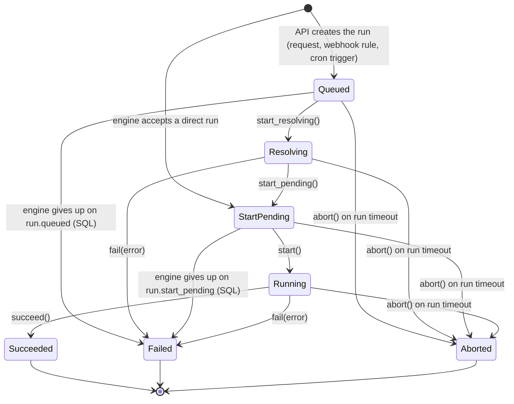
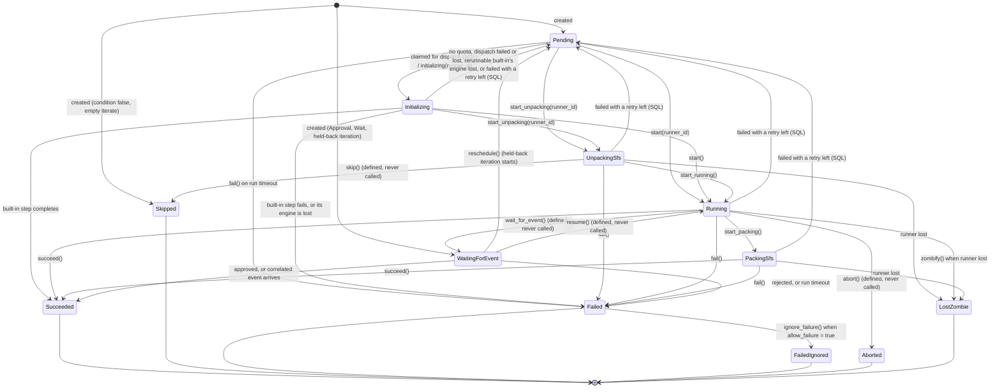

# Stormchaser State Machines

A run's status is `RunStatus` (`crates/stormchaser-model/src/workflow.rs`, Postgres
type `run_status`). A step's status is `StepStatus`
(`crates/stormchaser-model/src/step.rs`, Postgres type `step_status`).

The engine encodes the allowed transitions as typestate machines:
`WorkflowMachine<S>` in `crates/stormchaser-engine/src/workflow_machine.rs` and
`StepMachine<S>` in `crates/stormchaser-engine/src/step_machine/`. Each method moves
the row to a new status and saves it on the caller's connection. Some transitions
are made by SQL statements instead; the diagrams mark them `(SQL)`.

Two things the typestate does not do:

- Handlers rebuild a machine from the stored row with `from_instance` or
  `new_from_run`, and do not check that the stored status matches the state they
  name. The step completed and failed handlers build a `StepMachine<Running>` for a
  step in any non-terminal status.
- Run updates check the row's `version` (`persist_run` bails on a version mismatch).
  Step updates do not. What serialises a run's events is the lock the completed and
  failed handlers take on the run's row (`SELECT … FOR UPDATE`).

The database checks every step transition, whichever code makes it. A trigger on
`step_instances` refuses a move a step may not make (`step_status_transition_allowed`
in the `guard_step_transitions` migration): a step that has not finished may move to
any status, except that only a `pending` step is claimed (`initializing`), only a
`running` step packs its storage, and only a step that was handed out can become
`lost_zombie`. A finished step (`succeeded`, `failed_ignored`, `skipped`, `aborted`,
`lost_zombie`) never moves, and a `failed` one only to `failed_ignored`. A refused move
fails its statement with `check_violation`.

The diagram sources are `workflow_machine.mmd` and `step_machine.mmd` in this
directory.

## Workflow state machine

| Status | Meaning |
| :--- | :--- |
| `queued` | The API has saved the run and queued its `run.queued` event through the outbox. |
| `resolving` | The engine is fetching the workflow from Git, checking policy, running queries and decrypting SOPS secrets. `started_resolving_at` is set. |
| `start_pending` | Resolved; the engine is about to create the first steps. |
| `running` | Steps are being created and dispatched. |
| `succeeded` | Every step finished in a status that lets the run go on. |
| `failed` | A step failed (without `allow_failure`), or the run could not be resolved or started. `error` says why. |
| `aborted` | The run's `timeout` passed. |

Where each transition happens:

- **Created `queued`**: `POST /api/v1/runs`, a webhook event rule, or a cron trigger.
  The run and its `run.queued` event are written in one transaction.
- **Created `start_pending`**: a direct run (`POST /api/v1/runs/direct`). The API
  only queues a `run.direct` event; the engine creates the run when it accepts it.
  A direct run the engine refuses for good (DSL, policy, query or input errors) is
  inserted as `queued` and failed in the same transaction, then archived.
- **`queued` to `resolving` to `start_pending`**: `handle_workflow_queued`
  (`handler/workflow/queued.rs`).
- **`resolving` to `failed`**: a resolution error that is not transient, or the
  resolver crash recovery worker, which fails runs left `resolving` for more than
  5 minutes.
- **`queued` or `start_pending` to `failed`**: the engine gave up on the run's
  starting event after 10 deliveries (`handler/workflow/abandon.rs`,
  `fail_starting_workflow_run`).
- **`start_pending` to `running`**: `handle_workflow_start_pending`, after it has
  created the first steps.
- **`running` to `succeeded` or `failed`**: the step completed and step failed
  handlers. `fail()` and `abort()` on a running run also queue a
  `stormchaser.v1.runner.cancel` message so that runners stop the run's other steps.
- **Any non-terminal status to `aborted`**: the timeout worker
  (`handler/workflow/timeout.rs`). This is the only path to `aborted`; the API has no
  endpoint that cancels a run.

`StartPending::fail()` exists but is not called; `start_pending` runs are failed by
SQL.

A finished run is archived: its rows move to the `archived_*` tables
(`db/archive.rs`).

## Step state machine

| Status | Meaning |
| :--- | :--- |
| `pending` | Waiting to be dispatched: for its dependencies, for room under the run's quotas, or for `retry_at` before its next attempt. |
| `initializing` | Claimed by an engine for dispatch (`claimed_at` set). For a runner step, the task message is being published or a runner has taken it; for a built-in step, the engine is running it (`engine_id` set). |
| `unpacking_sfs` | The runner is restoring the step's parked storage. |
| `running` | The runner is executing the step. |
| `packing_sfs` | The runner is parking the step's storage. |
| `succeeded` | Finished successfully. |
| `failed` | Finished with an error, or failed by the run's timeout. |
| `failed_ignored` | Failed, but the step sets `allow_failure = true`, so its run goes on. |
| `skipped` | Its `condition` was false, or its `iterate` list was empty. |
| `waiting_for_event` | An `Approval` or `Wait` step waiting for a person or a correlated event, or an iteration held back by `max_parallel` or the run's `max_concurrency`. |
| `aborted` | Defined but never set. |
| `lost_zombie` | Its runner went offline, or sent no heartbeat for 30 seconds, while the step was in flight. |

`succeeded`, `failed`, `failed_ignored`, `skipped`, `aborted` and `lost_zombie` are
terminal (`is_terminal_step_status`). Only `succeeded`, `skipped` and
`failed_ignored` let the steps after it and the run go on
(`step_lets_run_continue`).

Where each transition happens:

- **Creation** (`handler/step/scheduling.rs`): `Approval`, `Wait` and
  `TerraformApproval` steps start `waiting_for_event`; iterations beyond
  `max_parallel` or the run's `max_concurrency` also start there and are moved to
  `pending` with `reschedule()` as earlier iterations finish. A step whose
  `condition` is false, or whose `iterate` list is empty, is created `skipped`.
  Everything else starts `pending`.
- **`pending` to `initializing`**: `claim_pending_step_instances_for_run` claims
  pending steps with `FOR UPDATE SKIP LOCKED`, so two engines never claim the same
  step. It skips steps whose `retry_at` is in the future. The runner's own
  `step.initializing` event moves a step that is still `pending`.
- **`initializing` back to `pending`** (SQL): the run has no CPU or memory quota left
  for the step, or publishing its task failed (`handler/mod.rs`); the dispatch
  recovery worker finds it claimed more than 5 minutes ago and never published
  (`reset_lost_dispatches`); or it is a `JQ` or `JinjaRender` step whose engine
  has sent no heartbeat for 60 seconds (`reset_lost_engine_steps`).
- **Runner progress**: `step.unpacking_sfs`, `step.running` and `step.packing_sfs`
  events (`handler/step/events/`).
- **Built-in steps** (run by the engine itself: `RestApi`, `SqlExecute`, `JQ`,
  `JinjaRender`, `WebhookInvoke`, `EmailSend`, `TestReportEmail`, `LambdaInvoke`,
  `SlackMessage`, `TeamsMessage`, `Wasm` and WASM-registered types) stay
  `initializing` until they report `step.completed` or `step.failed` through the
  outbox. If their engine stops sending heartbeats, the liveness worker fails them
  (except `JQ` and `JinjaRender`, which are put back to `pending`).
- **To `succeeded`**: a `step.completed` event, from a runner, a built-in step, or
  the API when an approval is approved or a correlated event arrives.
- **To `failed`**: a `step.failed` event, from the same sources (a rejected approval
  included), or the run timeout.
- **To `lost_zombie`**: the liveness worker queues a `step.failed` event with the
  error `lost_zombie` for each step in `running`, `unpacking_sfs` or `packing_sfs`
  whose runner is offline or silent for 30 seconds. The failed handler acts on it
  only if the runner is still lost when it arrives.
- **Retry** (SQL, `reset_step_for_retry`): when a step fails or is lost and its
  `retry` block has attempts left, the step goes straight back to `pending` with
  `attempt` incremented, `retry_at` set and a new `completion_token`. Its status
  history records the move back to `pending`; `attempt` counts the tries. The retry worker
  dispatches runs whose `retry_at` has passed. `Approval` and `Wait` steps are never
  retried.
- **`failed` to `failed_ignored`**: the failed handler, for a step with
  `allow_failure = true`. A lost runner is not covered: a `lost_zombie` step fails
  its run.

The run timeout fails steps in `pending`, `unpacking_sfs`, `running`, `packing_sfs`
and `waiting_for_event`. It leaves `initializing` steps as they are.

Transitions defined in `StepMachine` but never called: `UnpackingSfs::skip()`,
`Running::wait_for_event()`, `Running::abort()` and `WaitingForEvent::resume()`.

## Status history

A trigger on `step_instances` writes a row to `step_status_history` when a step is
created and whenever its status changes, whichever statement changes it: the
`StepMachine` methods and the SQL transitions above (claiming, putting back to
`pending`, retries) alike. Writing a step again with the status it has records
nothing.
Archived runs keep their history in `archived_step_status_history`;
`combined_step_status_history` reads both.
